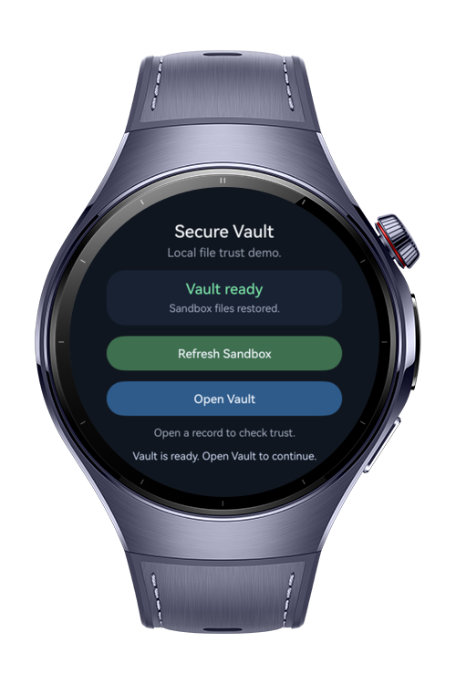
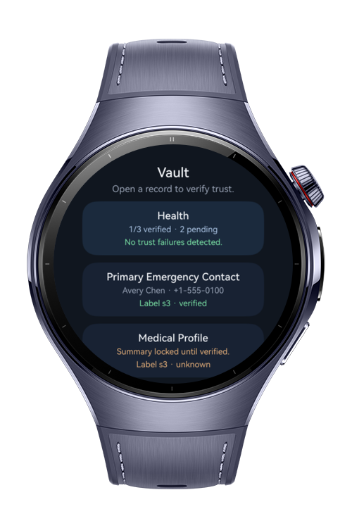
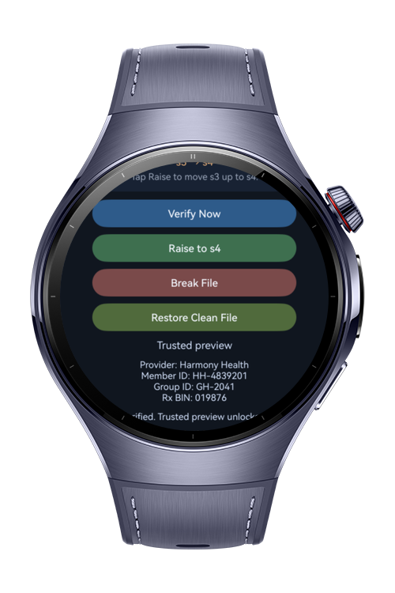
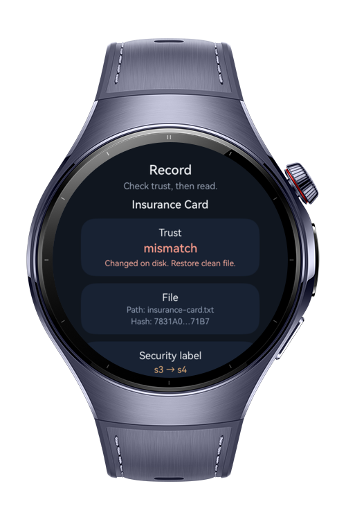

> **Note:** To access all shared projects, get information about environment setup, and view other guides, please visit [Explore-In-HMOS-Wearable Index](https://github.com/Explore-In-HMOS-Wearable/hmos-index).

# Secure File Vault

**Secure File Vault** is a HarmonyOS wearable sample app for storing and checking a small set of local emergency records on a circular watch screen. It creates sandbox-backed sample files, restores the vault across app restarts, verifies file integrity before showing trusted content, supports controlled file break/restore actions, exposes file security labels, and shows wearable-safe filesystem space metrics.

This project demonstrates local file access, file URI conversion, streaming SHA-256 verification with `HashStream`, data security labels, statfs-based storage diagnostics, reactive ArkUI state, HiLog warning output, and compact navigation for HarmonyOS wearable devices.

# Preview

<div>
  
  
  
  
</div>

# Use Cases

- **Local Emergency Records**: Seeds emergency contact, medical profile, and insurance card files in the application sandbox.
- **Trusted File Access**: Verifies each record with chunked SHA-256 hashing before unlocking the trusted preview.
- **File Tamper Demo**: Break File intentionally changes a sample file so the next verification reports a mismatch.
- **Clean File Recovery**: Restore Clean File writes the original sample content back and resets the expected hash.
- **Security Label Handling**: Reads real file security labels and raises them only when HarmonyOS allows a low-to-high label change.
- **State Persistence**: Restores vault metadata and sample files across app restarts without forcing setup every launch.
- **Storage Diagnostics**: Shows free and total filesystem space for the app sandbox using wearable-safe statfs APIs.
- **Round Watch UI**: Uses compact cards, short copy, scrollable pages, and centered layouts for small circular screens.

# Technology
## Stack
- **Languages**: ArkTS, ArkUI
- **Frameworks**: HarmonyOS SDK 6.0.1(21)
- **Tools**: DevEco Studio, Hvigor 6.0.1
- **Libraries**:
  - `@kit.AbilityKit`
  - `@kit.ArkUI`
  - `@kit.CoreFileKit`
  - `@kit.PerformanceAnalysisKit`
- **CoreFileKit Modules**:
  - `fileIo`
  - `fileUri`
  - `hash` / `HashStream`
  - `securityLabel`
  - `statfs`
- **Dev Dependencies**:
  - `@ohos/hypium`
  - `@ohos/hamock`

## Required Permissions
- No need to permissions.

# Directory Structure
```
Secure File Vault
|--- entry/src/main/ets/
| |--- entryability/
| | |--- EntryAbility.ets
| |
| |--- entrybackupability/
| | |--- EntryBackupAbility.ets
| |
| |--- model/
| | |--- VaultModels.ets
| |
| |--- pages/
| | |--- Index.ets
| |
| |--- state/
| | |--- VaultPageState.ets
| |
| |--- utils/
| | |--- VaultUiUtils.ets
| |
| |--- screenshots/
```

# Constraints and Restrictions
## Supported Device

* Huawei Watch 5

# License

**Secure File Vault** is distributed under the terms of the MIT License
See the [LICENSE](./LICENSE) for more information.
